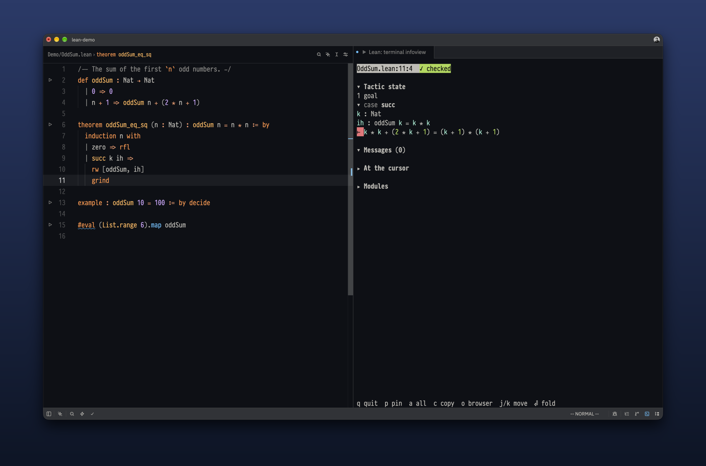

# Lean 4 IDE for Zed

[](https://github.com/jonaprieto/zed-lean4-ide/actions/workflows/ci.yml)
[](https://github.com/jonaprieto/zed-lean4-ide/releases/latest)
[](https://lean-lang.org/)
[](LICENSE.txt)

A [Lean 4](https://lean-lang.org/) extension for [Zed](https://zed.dev) with
an infoview. The goals, the expected type and the messages at your cursor
show in a terminal beside the code, and follow the cursor as you type. The
official Lean infoview can also open in your browser.



## Features

- Terminal infoview: tactic goals with case names and goal diffs, the
  expected type, messages and traces at the cursor, Lean's hover for the term
  under the cursor, the file's imports, and how far Lean has checked the file.
- Browser infoview: the official `@leanprover/infoview`, following the Zed
  cursor, with its edits and go-to-definition sent back to Zed.
- The goal state in hover, inside tactic proofs.
- Restart File when imports are out of date, from code actions or the
  infoview.
- Lake tasks: `lake build`, `lake update`, `lake clean` and fetching the
  Mathlib cache.
- Unicode abbreviations: type `\alpha` or `\to` and accept the completion
  with Tab. Hovering a symbol says how to type it.
- `sorry`, `admit` and `stop` stand out in the keyword color.

## Install

1. Install Lean with [elan](https://github.com/leanprover/elan#installation),
   for example `elan default stable`. The extension can also install elan for
   you; see [Settings](#settings).
2. Clone this repository and, in Zed, run `zed: install dev extension` and
   pick the clone. If the `lean4` extension from Zed's registry is installed,
   uninstall it first, since both serve Lean files.
3. Open a Lean project. The extension starts `lake serve` behind its proxy,
   `lean4-ide-proxy`, and downloads the proxy for your platform from the
   [releases](https://github.com/jonaprieto/zed-lean4-ide/releases) the
   first time. Builds are there for macOS and Linux (arm64 and x86_64) and
   Windows (x86_64).

## Recommended settings

Lean answers several requests that Zed leaves off by default, and an
extension cannot turn them on. Add them to your Zed `settings.json`:

```json
"languages": {
  "Lean 4": {
    "semantic_tokens": "combined",
    "inlay_hints": { "enabled": true },
    "document_folding_ranges": "on",
    "document_symbols": "on"
  }
}
```

They give Lean's own highlighting on top of tree-sitter's, the implicit
arguments Lean binds (such as ` {a b}` after a theorem's name), folding by
declaration, section and namespace, and an outline that follows Lean's
nesting. To put the infoview beside the code, as in the screenshot, also set:

```json
"terminal": { "dock": "right", "default_width": 450 }
```

The width is in pixels; 450 gives about 50 columns at a 15px font.

## Terminal infoview

Click the run button in the gutter on the first line of any command, such as
a declaration, `variable` or `#check`, or run the task "Lean: terminal
infoview" from `task: spawn`. The editor keeps focus, and the view follows the
cursor from then on, so you open it once per session.

Extensions cannot ship keybindings. To open it with a key, add this to your
keymap (`zed: open keymap`):

```json
{
  "context": "Editor && extension == lean",
  "bindings": {
    "ctrl-shift-i": ["task::Spawn", { "task_name": "Lean: terminal infoview" }]
  }
}
```

| Key | Does |
| --- | --- |
| `q`, `Esc`, `Ctrl-C` | quit |
| `p` | pin the current goals |
| `a` | all messages in the file |
| `c` | copy the goals into a comment in the buffer |
| `r` | restart the file when its imports are out of date |
| `o` | open the browser infoview |
| `j`, `k`, arrows | move the selection |
| `g`, `G` | jump to the top or bottom |
| `Enter`, space, `Tab` | fold the section, goal or message |
| `d`, `t` | with a term picked, go to its definition or its type |

The mouse works too. The wheel scrolls, a click on a header folds it, and a
click on a term in a goal shows its type and docstring. Hold Shift to select
text.

The first line shows how far Lean has checked the file: `⋯ checked through
line N` while it works, `✓ checked` when done, and `✗ stopped at line N` when
it gave up.

## Browser infoview

Press `o` in the terminal infoview, or set `infoview.open` to `"browser"` and
choose Open Lean Infoview from Zed's code actions. Lean widgets render HTML,
which a terminal cannot show, so open this one for them.

The proxy serves the page on a random loopback port, and the URL carries a
token. Anyone with the URL can read your open Lean files and edit them through
Zed, so keep it private. Widgets run in the page with the same access, so only
open trusted projects. Remote worktrees are not supported.

## Settings

Everything lives under `lsp.lean4-ide` in your Zed settings:

```json
"lsp": {
  "lean4-ide": {
    "settings": {
      "infoview": {
        "open": "terminal",
        "theme": { "keyword": "light-magenta", "selection": { "bg": "236" } }
      },
      "lean_project_dir": "formalization",
      "elan_auto_install": true,
      "elan_default_toolchain": "stable"
    }
  }
}
```

- `infoview.open`: `"terminal"` (the default) or `"browser"`.
- `infoview.theme`: colors of the terminal infoview by role. By default it
  uses the terminal's colors, which follow your Zed theme. A role takes a
  color (`red`, `#rrggbb` or a 256-color index such as `"236"`) or an object
  with `fg`, `bg` and `modifiers`. The roles are `hypothesis`, `goal_prefix`,
  `inaccessible`, `case_name`, `inserted`, `removed`, `keyword`, `literal`,
  `trace_class`, `selection`, `heading`, `docs`, `link`, `error`, `warning`,
  `information`, `hint`, `checked` and `checking`. Changes apply without a
  restart.
- `lean_project_dir`: the Lean project inside the worktree, when the worktree
  is a parent of it. Relative to the worktree root, or absolute.
- `elan_auto_install`: install elan if no Lean is found, with
  `elan_default_toolchain` (`"stable"`, `"nightly"` or a version such as
  `"v4.28.0"`). Remove it later with `elan self uninstall`.
- `proxy`: `false` runs plain `lake serve`, without the infoviews or goals in
  hover.

To run a specific Lake, set `lsp.lean4-ide.binary` with its `path` and
`arguments` (for example `["--dir", "/path/to/project", "serve", "--"]`). This
bypasses the proxy. Without it, the extension looks for `lake` on your `PATH`,
then in `$ELAN_HOME` and elan's default directory.

## Development

See [HACKING.md](HACKING.md).

## Credits

This is a fork of [reuixiy7/zed-lean4](https://github.com/reuixiy7/zed-lean4)
that takes a different approach to the infoview. Upstream writes the goals to
`.lake/InfoView.md` and shows them in Zed's Markdown preview, which is a
perfectly good way to use Lean in Zed. This fork runs the infoview in Zed's
terminal instead, so it can be interactive: folding sections, clicking a term
for its type, jumping to definitions, and opening the official infoview in
the browser for widgets.

The grammar is [tree-sitter-lean](https://github.com/jonaprieto/tree-sitter-lean),
a fork of [Julian/tree-sitter-lean](https://github.com/Julian/tree-sitter-lean).
Licensed under [Apache-2.0](LICENSE.txt).
